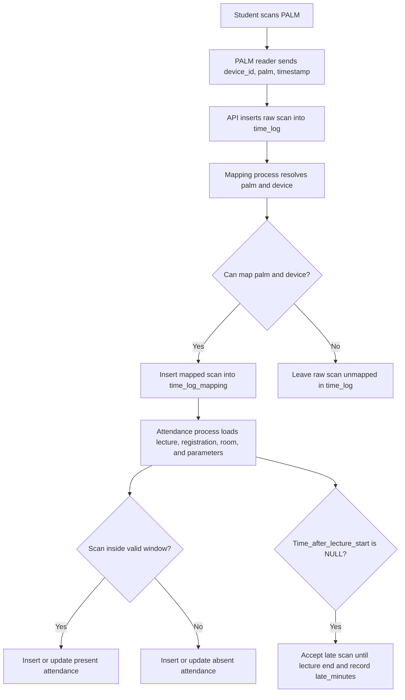

# UREP Student Attendance API Report

## Project Requirements

The student attendance project uses PALM reader devices to register attendance. The workflow from the provided DOCX is:

- Register each student's PALM value and link it to the university student ID.
- Configure each PALM reader with the server address, correct device time, network access, and a unique device ID.
- Receive scan data from the device on the server.
- Save raw device scans into `time_log`.
- Map raw scans into student-aware and room-aware rows in `time_log_mapping`.
- Use simulated SIS tables for courses, rooms, schedules, registrations, and lectures until the real SIS integration is ready.
- Process mapped scans into lecture-level student attendance.

The source document also identifies operational questions that still belong to the broader project: device manual review, device server setup, network behavior, offline buffering, PALM registration procedure, database connection setup, device ID discovery, timestamp format, and SIS field formats.

## Ali-Specific Requirements

The Ali task PDF assigns the attendance-logic portion of the project:

- Define attendance parameters with default values and descriptions.
- Implement a process that reads `time_log_mapping` and fills the attendance table.
- Document the complete scan-to-attendance flow.
- Prove that the logic respects the early and late thresholds.
- If `Time_after_lecture_start` is `NULL`, accept late scans until lecture end and record total late minutes instead of marking the student absent.

Default parameters implemented in PostgreSQL:

| Parameter | Default | Meaning |
| --- | ---: | --- |
| `Time_before_lecture_start` | `10` | A scan is valid up to 10 minutes before lecture start. Earlier scans do not count. |
| `Time_after_lecture_start` | `20` | A scan is valid up to 20 minutes after lecture start. If null, late minutes are recorded until lecture end. |

## PostgreSQL Schema Overview

The API uses the ERM from the DOCX as the base model and adjusts data types for PostgreSQL:

- `palm_reg`: maps `student_palm` to `student_id`.
- `rooms`: stores university rooms.
- `device_room`: maps a physical reader `device_id` to a room.
- `time_log`: stores raw device scan events.
- `time_log_mapping`: stores resolved scan events with `student_id` and `room_id`.
- `courses`: stores course subject and number.
- `schedule`: stores section offerings by year, semester, course, room, and section.
- `registration`: links students to scheduled sections.
- `lectures`: stores dated lecture occurrences with start and end time.
- `parameters`: stores attendance rules.
- `student_attendance`: stores final per-student, per-lecture attendance status.

`student_attendance` includes implementation fields required by the Ali task:

- `status`: `present` or `absent`.
- `scan_time`: the scan used for attendance, when present.
- `late_minutes`: populated when `Time_after_lecture_start` is null and the scan is late.
- `reason`: a short explanation of why the row was marked present or absent.

## Attendance Processing Flow



The attendance process creates one row per registered student per lecture. This means students with no valid scan are explicitly marked absent.

## Attendance Rules

For each lecture, the API computes:

- `lecture_start = lecture_date + start_time`
- `lecture_end = lecture_date + end_time`
- `earliest_valid_scan = lecture_start - Time_before_lecture_start`
- `latest_valid_scan = lecture_start + Time_after_lecture_start`

When `Time_after_lecture_start` is not null:

- Scans before `earliest_valid_scan` are invalid.
- Scans after `latest_valid_scan` are invalid.
- Scans inside the window mark the student present.

When `Time_after_lecture_start` is null:

- Scans before `earliest_valid_scan` are invalid.
- Scans from lecture start through lecture end are accepted.
- Late scans store `late_minutes`.

If a student scans multiple times for the same lecture, the earliest valid scan is used.

## API Endpoints

| Method | Path | Purpose |
| --- | --- | --- |
| `GET` | `/health` | Confirms the API and database are reachable. |
| `GET` | `/parameters` | Lists attendance parameters. |
| `PUT` | `/parameters/:name` | Updates a parameter value, including setting `Time_after_lecture_start` to `null`. |
| `POST` | `/time-logs` | Inserts a raw PALM reader scan. |
| `POST` | `/time-logs/batch` | Inserts up to 1000 buffered scans from a reader that was offline. |
| `POST` | `/time-log-mappings/process` | Maps raw logs to student and room records. |
| `POST` | `/attendance/process` | Processes mapped logs into attendance rows. |
| `GET` | `/attendance` | Lists attendance rows with optional filters. |
| `GET` | `/students/:id/overview` | One student's sections, lectures, palm registration, raw scans, attendance and parameters, for the student app. |

Example scan request:

```json
{
  "device_id": "device-b-101",
  "student_palm": "demo-palm-1",
  "scan_time": "2026-06-09T09:05:00+03:00"
}
```

Example attendance processing request:

```json
{
  "lecture_id": 1
}
```

## Verification Scenarios

The intended test scenarios are:

- Health endpoint succeeds.
- Parameters can be listed and updated.
- `Time_after_lecture_start` can be set to null.
- Raw scan is inserted into `time_log`.
- Known palm and device records map into `time_log_mapping`.
- Scan at lecture start is present.
- Scan at earliest allowed time is present.
- Scan before the early threshold is absent.
- Scan inside the late threshold is present.
- Scan after the late threshold is absent.
- Null late threshold records `late_minutes`.
- No scan creates absent attendance.
- Multiple scans use the earliest valid scan.
- Wrong-room scan does not count.
- Unknown palm/device remains unmapped.
