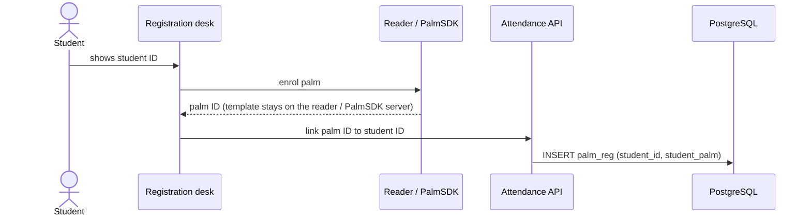
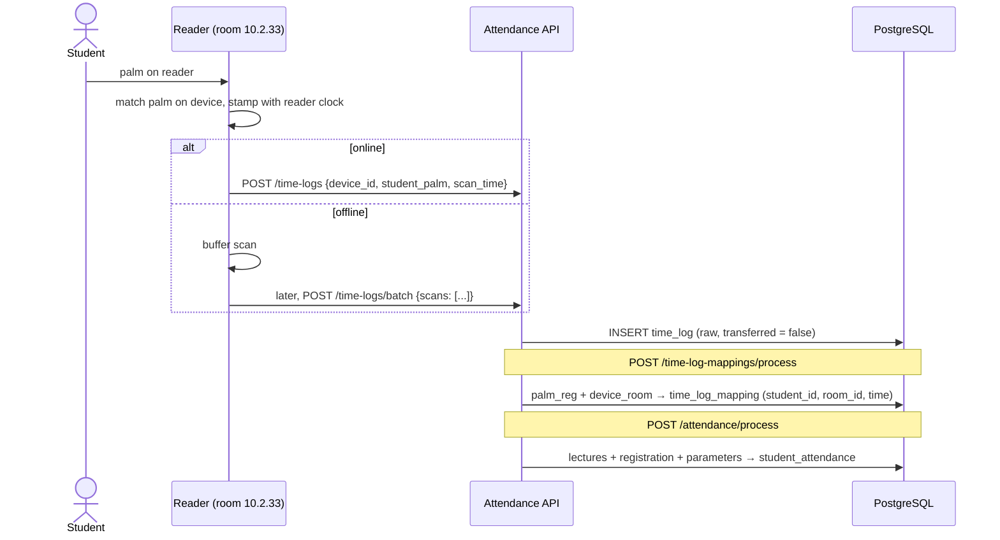

# Data flow: palm reader to attendance

How a palm scan becomes a lecture attendance record, which parts exist today, and where the simulator stands in for hardware that is not ready yet.

The schema is Dr. Ghassan's ERM from the project tasks document, implemented in PostgreSQL. The diagram is in [erd.png](erd.png), generated from [erd.mmd](erd.mmd). Migration `003` adds display fields the app needs from the SIS: a `students` stand-in table (name, programme), `courses.title` and `schedule.instructor`. They are all nullable, outside the attendance logic, and filled by the simulator until the real SIS is connected.

## Components

| Component | Status | Notes |
| --- | --- | --- |
| Palm reader (WavePass500) | Being configured by Dr. Wagdi and Azka | Vendor docs shared 18 Jun 2026: spec, *Small Scale PalmSDK-L (Server version) User Guide*, free 10,000-ID POC licence. The Android SDK came on 23 Sep 2026. Dr. Wagdi is writing a small app on the device to work around its limitations. |
| Reader simulator | Built (`npm run sim`) | Stands in for the readers. It posts the same request a reader will post. |
| Attendance API | Built and hosted (this repo) | Express + PostgreSQL. It receives scans, maps them and computes attendance. A read-only public view runs at https://attendance-api.alirezaafshan.com. |
| SIS | Simulated | `courses`, `rooms`, `schedule`, `registration` and `lectures` hold demo data until the university SIS fields are confirmed. |
| Student app | Reads this API | `urep-student-attendance/mobile-app` signs in with a student ID and loads `GET /students/:id/overview` through its same-origin `/api` proxy. Its `src/domain/pipeline.ts` mirrors the API rules, to explain each scan and preview other parameter values. |

## 1. Palm registration (once per student)



The desk step (linking the palm ID to the student ID) has no endpoint yet. The simulator writes `palm_reg` directly. **Open question:** does the reader return a stable palm/user ID we can store, or do we set the ID ourselves at enrolment, for example the student ID?

## 2. Scan to attendance (every class)



Rules applied by `/attendance/process`, with the defaults in `parameters`:

- The valid window opens `Time_before_lecture_start` (10) minutes before the lecture starts.
- It closes `Time_after_lecture_start` (20) minutes after the start. If that value is `NULL`, it closes at the lecture end and the late minutes are recorded.
- The scan must come from a reader linked to the lecture's room. The earliest valid scan counts.
- Every registered student gets a row. Students with no valid scan are marked `absent` with a reason.

The scan time used is the **reader's own clock**, not the time the server received it. That is why buffered scans still count, and why reader clock drift matters (see below).

## 3. What the simulator models

`src/simulator/` creates a seeded, reproducible campus, then plays out a teaching day as the readers would see it:

- **Campus:** 6 rooms in UDST-style numbering (`10.2.33`), one WavePass500 per room, and a seventh reader in a corridor that was never linked in `device_room`. There are 7 courses and 12 sections on a Sunday to Thursday timetable, and 90 students with clash-free registrations of 4 or 5 courses, plus a lab.
- **Students:** each has a behaviour profile (punctual, typical, late-prone, disengaged) that drives attendance probability and arrival time. About 6% have palm trouble: enrolled on the reader but never linked in `palm_reg`, or never enrolled, so the reader rejects them.
- **Messy reality:** students who skip class or forget to scan, rescans (duplicates), scans at the wrong room's reader, scans at the corridor reader, back-to-back classes where students arrive too early, visitors and staff with unknown palms, and lunchtime walk-by scans.
- **Readers:** each has clock drift (one reader runs 95 s fast). On about half of the days, one reader loses the network around a lecture, buffers its scans, and flushes them as one batch when it reconnects.

For every day the simulator also works out, independently of the API's SQL, which attendance rows should result and why (`counted`, `skipped_class`, `palm_not_linked`, `scanned_wrong_reader` and so on). `npm run sim -- day` compares those against what the API produced. A simulated week of about 930 rows matches exactly (see `tests/simulator.integration.test.ts`).

### Things the simulation surfaced

- **Clock drift flips outcomes.** Over one simulated week, 3 students were marked differently because a reader clock was 95 s off: the scan was inside the window in true time but outside it on the reader's clock. Readers need NTP or a regular time sync.
- **Back-to-back classes.** A student leaving a class that ends at 09:15 who scans for a 09:30 class at 09:18 is 12 minutes early and does not count with the default 10-minute margin.
- **Unlinked palms are silent failures.** A student enrolled on the reader but missing from `palm_reg` scans normally and is still marked absent. The app should show them unmapped scans.
- **Unmapped scans pile up.** Visitors and the unlinked corridor reader leave `time_log` rows with `transferred = false` forever. They need a review screen or cleanup.

## Running it

```bash
npm run sim -- campus                                   # print the simulated campus (students, palm IDs, readers)
npm run sim -- seed --from 2026-10-25 --to 2026-10-29   # write the SIS stand-in data, palm_reg and device_room
npm run sim -- day --date 2026-10-25                    # send a day of scans to the API and verify the result
npm run sim -- day --date 2026-10-25 --speed 60 --live  # replay in real time (60x), processing as scans arrive
npm run sim -- day --date 2026-10-25 --dry-run          # summary only, sends nothing
npm run sim -- scan --device WP500-Q24A0101 --palm PV-XXXXXXXX --at 2026-10-25T08:02:00+03:00
```

`seed` writes to the database in `DATABASE_URL`. The other commands talk to the API at `--api` (default `http://localhost:3000`, or `SIM_API_URL`), the same way a real reader would.
